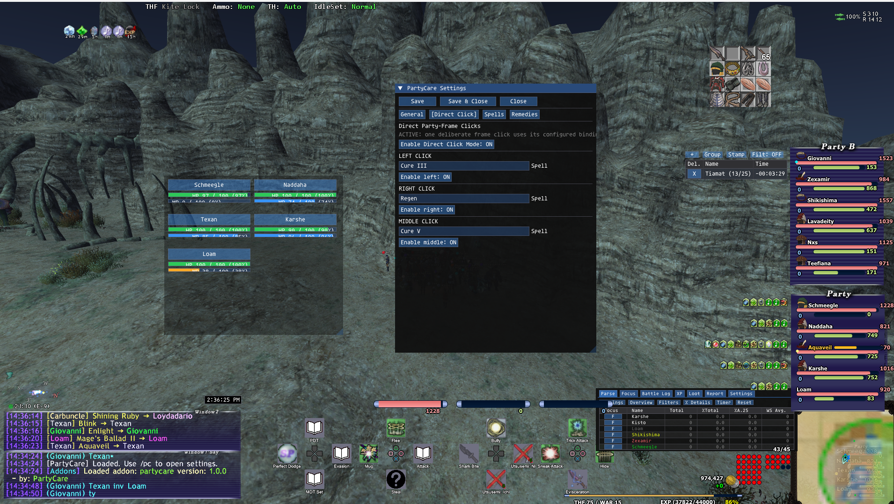

# PartyCare for Windower

> **By: Schmeee**



PartyCare for Windower is a compact transparent party and alliance grid for direct, player-initiated healing actions. It shares PartyCare’s configuration, HP/MP visual states, direct-click bindings, Alliance 2/3 support, and guardrails while using Windower-specific party, mouse, text, and command APIs.

## Install

Copy the `partycare` folder into `Windower4/addons/partycare`, then load it in game:

```text
//lua load partycare
```

Use either command below to show or hide the Windower settings summary:

```text
//partycare
//pc
```

## Grid and Alliance Members

PartyCare reads Windower’s `p0`–`p5`, `a10`–`a15`, and `a20`–`a25` party data keys into the same local, Alliance 2, and Alliance 3 model used by the Ashita release. Enable `show_alliance_2` or `show_alliance_3` in `settings.lua` to render those group sections when they contain active members.

Each direct click is tied to the member’s displayed slot. Local party requests use `<p0>`–`<p5>`; Alliance 2 uses `<a10>`–`<a15>` and Alliance 3 uses `<a20>`–`<a25>`.[1]

## Direct Clicks

Left, right, and middle releases can be configured in `settings.lua` through the `direct_click` table. A direct click produces at most one configured spell request for the card under the pointer. The manual dispatcher is controlled by:

```text
//pc dispatch on
//pc dispatch off
```

The `off` command is an immediate emergency disable. PartyCare contains no health-triggered casting, timers, queues, retries, hover casts, or background actions.

## Settings

The shared `settings.lua` file controls grid size, columns, MP display, transparency, Alliance 2/3 visibility, direct-click spell names, optional Refresh, and remedy priorities. This first Windower release uses a compact in-game settings summary and expects customization through the settings file; the Ashita build provides the full tabbed in-game editor.

## Packet-Backed Remedy Scope

PartyCare now reads Windower’s incoming `0x076` party-status packet for remote members of the active party and uses the local player buff list for the local member. It recognizes the configured removable effects including Poison, Slow, Paralysis, Silence, Blindness, Petrification, Curse, Doom, Disease, Plague, Bind, Gravity, Bio, Dia, Addle, Flash, Stun, Elegy, Requiem, and Helix. Generic stat-down effects, including Evasion Down, are intentionally suppressed from automatic broad-Erase recommendations until a verified per-effect remedy mapping is available. The compact alert and normal panel show only a remedy selected by the configured priority list.

When Windower can determine the local spellbook, PartyCare skips an unlearned high-priority spell and falls through to the next learned, enabled remedy. For example, Slow plus Poison shows Poisona when Erase is unlearned and Poisona is learned. Status packet records apply to the active party; Alliance 2 and 3 remain safely status-unknown when Windower does not provide a corresponding remote status record.

## Refresh Pulse and Compact Alert

Use the commands below, then `//pc save` to persist the setting.

```text
//pc refreshpulse on|off
//pc compact on|off
//pc alertpreview on|off
//pc alertpos <x> <y>
```

Refresh pulse visibly colors a member name only when PartyCare has a usable status record, the Refresh icon is confirmed absent, and the member’s current MP exceeds `refresh_min_mp`. Percentage-only records remain safely excluded.

Compact mode is fully hidden while no enabled, learned remedy is actionable. When an actionable status appears, it reveals only the affected member’s name in a pulsing red treatment and one deliberate, priority-selected Remedy click area. Turning compact mode on enables a blank placement preview; turn `alertpreview` off after positioning it. The text-based Windower renderer does not expose a clickable tabbed menu, so these options are available through `//pc` commands and `settings.lua`.

## References

[1]: https://horizonffxi.wiki/Macro "HorizonXI Macro Target Placeholders"
[2]: https://github.com/Tylas11/XivParty "XivParty Windower party-status packet reference"
